# Bazaarly — Enterprise Multi-Vendor eCommerce Platform

Bazaarly is a modern, production-grade, multi-vendor eCommerce ecosystem designed for high performance, transactional safety, and strict separation of concerns across multiple merchants and administrators.

---

## 🌟 Key Architecture & Technical Highlights

- **Backend:** FastAPI (Python 3.13) with asynchronous request handlers, strict Pydantic v2 domain schemas, and clean architectural separation.
- **Database:** SQLite running in **WAL (Write-Ahead Logging)** mode with `PRAGMA foreign_keys = ON;`, atomic suborder splitting, and transactional inventory decrement.
- **Role-Based Portals (RBAC):** Strict JWT token authentication with 4 dedicated roles:
  1. **Customer:** Storefront browsing, variant selection, persistent cart, coupon engine, multi-gateway checkout, order tracking, printable invoices, and verified reviews.
  2. **Seller (Merchant):** Store catalog CRUD, SKU and variant control, inventory decrement alerts, vendor suborders management, monthly revenue Chart.js analytics, and payout withdrawals.
  3. **Operations Admin:** Merchant application approval/rejection, catalog moderation, global order auditing, dispute resolution & transaction refunds, and CSV sales exports.
  4. **Super Admin:** Executive governance, platform commission rate configuration, sales tax & shipping policy controls, staff administrator provisioning, and immutable audit logging.
- **Multi-Gateway Payment Layer:** Abstracted payment drivers supporting **Stripe (Card)**, **Cash On Delivery (COD)**, **SSLCommerz (Mobile/Net Banking)**, and **Direct Bank Transfer**.
- **Frontend UI/UX:** Clean, modern white theme (`#FFFFFF` primary, `#F8FAFC` secondary, `#111827` dark charcoal text, `#2563EB` modern blue accent) built with Tailwind CSS, Lucide Icons, and Chart.js.

---

## 👥 Demo Accounts & One-Click Switching

The platform includes a built-in **Role Switcher Pill** in the header navigation that allows instantaneous switching between all 4 personas without manual login forms:

| Role | Demo Email | Password | Primary Capabilities |
| :--- | :--- | :--- | :--- |
| **Customer** | `john.doe@example.com` | `password123` | Browsing, cart, checkout, tracking, reviews |
| **Customer (Alt)** | `jane.smith@example.com` | `password123` | Active orders, address management |
| **Seller (Approved)**| `techstore@bazaarly.com` | `password123` | Nexus Electronics store manager, order fulfillment |
| **Seller (Fashion)** | `fashionhub@bazaarly.com`| `password123` | Urban Weave Apparel inventory manager |
| **Seller (Pending)** | `gadgetverse@bazaarly.com`| `password123`| Pending application awaiting Admin review |
| **Operations Admin**| `admin@bazaarly.com` | `password123` | Merchant onboarding, catalog moderation, dispute refunds |
| **Super Admin** | `superadmin@bazaarly.com` | `password123`| Global commission rates, audit logs, staff provisioning |

---

## 🛍️ Complete eCommerce Workflow

```mermaid
flowchart LR
    A["Catalog Browsing"] --> B["Select Variants & Quantity"]
    B --> C["Add to Cart & Apply Coupon"]
    C --> D["Multi-Step Checkout"]
    D --> E["Payment Execution (Stripe/COD/SSL)"]
    E --> F["Atomic Stock Reservation"]
    F --> G["Split Suborders Per Merchant"]
    G --> H["Merchant Fulfillment & Packing"]
    H --> I["Unified Customer Delivery & Reviews"]
```



1. **Product Selection & Stock Verification:** Real-time stock checks on variants (Color, Size, Storage).
2. **Shopping Cart & Coupons:** Server-side price recalculation prevents client-side tampering. Supports percentage (`WELCOME10` - 10% off) and flat discounts (`BAZAAR50` - $50 off).
3. **Multi-Vendor Suborder Splitting:** When an order contains items from multiple sellers (e.g. Nexus Electronics and Urban Weave), the backend creates individual `seller_orders` records. Each vendor only views and updates items from their own warehouse.
4. **Dispute Resolution & Inventory Replenishment:** When an administrator or customer cancels or refunds an order, inventory quantities are atomically returned to the catalog.

---

## 🚀 Quickstart & Server Execution

### 1. Run Server
From the project directory:
```bash
python run.py --port 8005
```

### 2. Access the Application
- **Customer Storefront & Portals:** [http://localhost:8005/](http://localhost:8005/)
- **Interactive Swagger REST API:** [http://localhost:8005/docs](http://localhost:8005/docs)
- **Health Check Status:** [http://localhost:8005/api/status](http://localhost:8005/api/status)

### 3. Run Automated Tests
```bash
python -m unittest discover -s tests -p "test_*.py"
```

---

## 📁 Project Structure

```
bazaarly/
├── bazaarly/
│   ├── api/
│   │   ├── admin_routes.py         # Merchant approvals, disputes, CSV export
│   │   ├── auth_routes.py          # JWT login, registration, role switcher
│   │   ├── cart_routes.py          # Cart CRUD, persistent totals, coupons
│   │   ├── catalog_routes.py       # Products search, categories, reviews
│   │   ├── order_routes.py         # Checkout, multi-vendor suborders
│   │   ├── seller_routes.py        # Merchant inventory, orders, revenue
│   │   ├── super_admin_routes.py   # Global rates, staff admins, audit trail
│   │   └── server.py               # FastAPI application & static mount
│   ├── core/
│   │   ├── inventory.py            # Atomic stock reservation engine
│   │   ├── models.py               # Pydantic v2 request/response schemas
│   │   ├── payments.py             # Multi-provider payment gateway driver
│   │   └── security.py             # JWT token generation & RBAC guards
│   ├── db/
│   │   └── database.py             # SQLite WAL schema & comprehensive seed data
│   └── web/
│       └── static/
│           ├── app.js              # Client application state & event handlers
│           ├── index.html          # Responsive single-page application
│           └── styles.css          # Custom typography and print invoice styling
├── data/
│   └── bazaarly.db                 # Persistent SQLite database
├── tests/
│   └── test_ecommerce_flows.py     # 8 automated end-to-end test cases
├── requirements.txt                # Dependencies specification
├── run.py                          # Application entry point runner
└── README.md                       # System documentation
```
